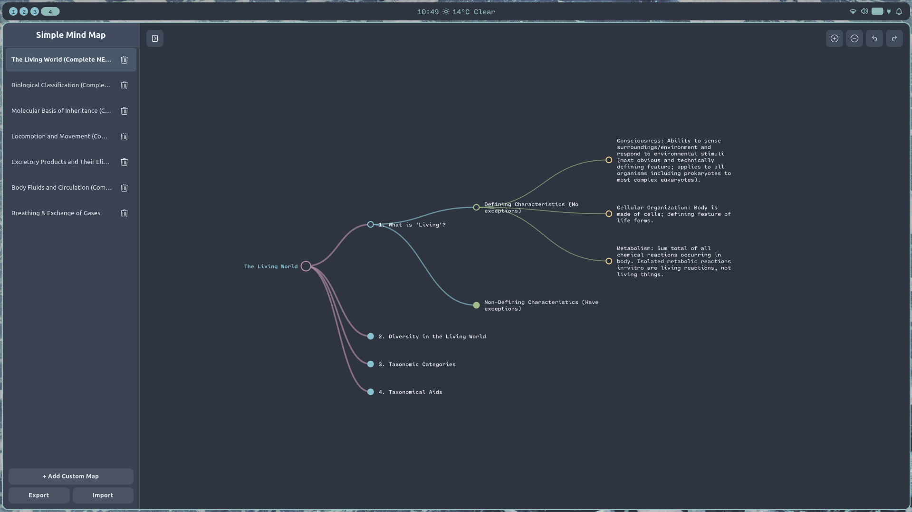

# Simple Mind Map (Native GTK 4 / Libadwaita)

A lightning-fast, native mind mapping application built with **GTK 4**, **Libadwaita**, and **Cairo**, styled with a gorgeous **Nord theme**. Designed for distraction-free organization, deep multi-layered hierarchies, and silky-smooth collapse/expand branch animations.

---

## Screenshot


---

## Key Features

* **Blazing Fast & Native**: Written in pure C utilizing Cairo and Pango for hardware-accelerated, crisp vector rendering without web-view overhead.
* **Buttery-Smooth Animations**: Features custom frame-clock tick animations with cubic/quart ease-out curves that smoothly slide and fade sub-branches in and out across multi-layered trees.
* **Nord Theme Palette**: Deep, eye-friendly dark mode aesthetics (`#2e3440` background with coordinated Nord accents) designed to reduce eye strain during long study or brainstorming sessions.
* **Multi-Chapter Management**: Easily organize different topics or subjects in a clean collapsible sidebar.
* **Rich Node Media**: Attach images directly to nodes via file dialog or clipboard paste (`Ctrl+V`), with adjustable image sizing.
* **Keyboard & Modal Efficiency**: Quick branch creation (`Tab`), inline popover text editing, and full undo/redo history support (`Ctrl+Z` / `Ctrl+Y`).
* **JSON Export/Import**: Easily backup, share, or port your mind maps as clean JSON files.

---

## AI-Assisted Development Disclosure

This project was built through a highly collaborative, interactive human-AI engineering workflow.
While the architectural concept, design vision, testing, and system integration were driven by the human creator,
**the underlying C source implementation, layout mathematics, custom Cairo rendering loops, and optimization routines were co-created with AI assistance**. 

---

## Building & Installation

### Dependencies
Ensure you have the following development packages installed on your system:
* `gtk4`
* `libadwaita-1`
* `json-glib-1.0`

### Compile from Source
```bash
gcc -O2 mindmap_native.c -o mindmap_native -lm $(pkg-config --cflags --libs libadwaita-1 json-glib-1.0)